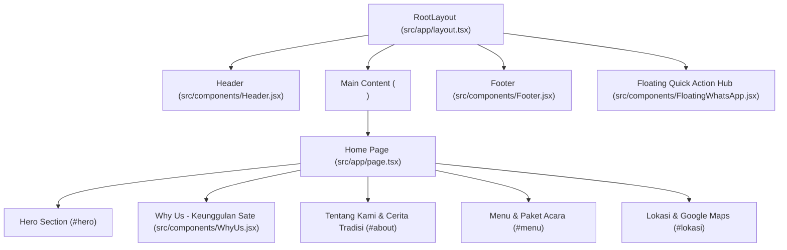

# 📖 Dokumentasi & Ikhtisar Proyek: Sate Ayam Ponorogo Mas Yudi

Dokumentasi ini disusun sebagai panduan lengkap untuk memahami struktur, alur, status pengerjaan, dan panduan teknis proyek website **Sate Ayam Ponorogo Mas Yudi**. Dokumen ini telah diperbarui sesuai arsitektur landing page terbaru.

---

## 📌 1. Ringkasan Proyek

| Informasi | Deskripsi |
| :--- | :--- |
| **Nama Proyek** | Sate Ayam Ponorogo Mas Yudi (`sate-ayam-ponorogo`) |
| **Tipe Aplikasi** | Single Page Landing Page & Pemesanan Kuliner UMKM |
| **Framework** | [Next.js](https://nextjs.org/) 16.3.5 (App Router, Turbopack) |
| **Library UI** | [React](https://react.dev/) 19.2.8 |
| **Styling** | [Tailwind CSS](https://tailwindcss.com/) v4 (`@tailwindcss/postcss`) |
| **Ikon** | Bootstrap Icons (SVG resmi standar web) |
| **Bahasa** | TypeScript (`.ts`, `.tsx`) & JavaScript (`.jsx`) |
| **Integrasi Utama** | WhatsApp Ordering API terkontekstualisasi & Google Maps (Embed + Navigasi) |

---

## 🏗️ 2. Arsitektur Halaman & Komponen

Website ini menggunakan konsep **Single Page Application (SPA)** berkinerja tinggi, di mana seluruh konten terpenting dapat diakses langsung di beranda dengan navigasi *smooth scroll*:



---

## 📂 3. Struktur File & Direktori

```text
sate-ayam-ponorogo/
├── public/                     # Aset statis
│   ├── logo.png                # Logo resmi Mas Yudi (dipakai di Header, Footer, Popup)
│   ├── main-bg.jpg             # Foto proses bakar sate di arang untuk Hero section
│   └── ko.jpg                  # Foto produk sate ayam asli siap saji
├── src/
│   ├── app/                    # Next.js App Router
│   │   ├── about/
│   │   │   └── page.jsx        # Redirect otomatis ke /#about
│   │   ├── favicon.ico         # Favicon tab browser
│   │   ├── globals.css         # CSS utama (Tailwind v4 + smooth scroll behavior)
│   │   ├── layout.tsx          # Root Layout (Header, Footer, Floating Hub, SEO Schema.org)
│   │   └── page.tsx            # Beranda utama (Hero, WhyUs, About, Menu, Lokasi)
│   └── components/             # Komponen UI modular
│       ├── FloatingWhatsApp.jsx # Widget aksi cepat kanan bawah (Chat WA + 2 Peta Maps)
│       ├── Footer.jsx          # Footer bawah dengan kontak & navigasi
│       ├── Header.jsx          # Navbar atas fixed/sticky dengan efek backdrop blur
│       ├── LocationSection.jsx # Informasi 2 sesi lokasi + Embed Google Maps interaktif
│       ├── MenuPreview.jsx     # Varian sate (Filter tabs, direct WA) & Paket Besek/Acara
│       └── WhyUs.jsx           # 3 Kartu keunggulan dengan Bootstrap Icons resmi
├── .gitignore                  # File/folder yang diabaikan Git
├── eslint.config.mjs           # Konfigurasi ESLint 9
├── next.config.ts              # Konfigurasi Next.js
├── package.json                # Daftar dependensi & npm scripts
├── postcss.config.mjs          # Konfigurasi PostCSS untuk Tailwind v4
├── PROJECT_OVERVIEW.md         # Dokumentasi resmi proyek
├── tailwind.config.js          # Konfigurasi kustom tema warna Tailwind
└── tsconfig.json               # Konfigurasi TypeScript & path alias (@/*)
```

---

## 🔍 4. Penjelasan Detail Setiap Komponen

### 4.1. Navbar ([`Header.jsx`](file:///c:/Users/Andika%20Wahyu/sate-ayam-ponorogo/src/components/Header.jsx))
* Memiliki efek *backdrop-blur* saat di-scroll melebihi area Hero.
* Navigasi desktop dan mobile menu (*hamburger*) mengarah mulus ke:
  * `/#hero` (Home)
  * `/#about` (Tentang Kami)
  * `/#menu` (Menu)
  * `/#lokasi` (Lokasi)
* Tombol CTA *"Pesan Sekarang"* yang langsung membuka WhatsApp dengan template pesan website.

### 4.2. Hero Section ([`src/app/page.tsx`](file:///c:/Users/Andika%20Wahyu/sate-ayam-ponorogo/src/app/page.tsx))
* Menggunakan background foto bakaran sate dengan *dark vignette overlay* sehingga transisi dari navbar ke foto sangat natural tanpa ada tulisan gambar yang terpotong.
* **Dual Call to Action (CTA)**: Tombol utama pemesanan WhatsApp + tombol penjelajah menu.
* Tiga penegas mutu (*100% Daging Ayam Pilihan*, *Bumbu Kacang Halus Sangrai*, *Kemasan Besek & Acara*).

### 4.3. Keunggulan Kami ([`WhyUs.jsx`](file:///c:/Users/Andika%20Wahyu/sate-ayam-ponorogo/src/components/WhyUs.jsx))
* Tiga kartu keunggulan kuliner Mas Yudi:
  1. **Daging Sayat Pipih**: `bi-check-circle-fill` (Empuk & matang merata tanpa gosong).
  2. **Rempah Marinasi Meresap**: `bi-fire` (Bumbu tradisi meresap sebelum dibakar).
  3. **Bumbu Kacang Halus Sangrai**: `bi-heart-fill` (Tekstur lembut, manis-gurih pas di lidah).
* Dilengkapi penegas kualitas resmi *"Standar Mutu Mas Yudi"*.

### 4.4. Tentang Kami & Cerita Tradisi (`#about` di [`page.tsx`](file:///c:/Users/Andika%20Wahyu/sate-ayam-ponorogo/src/app/page.tsx))
* Terintegrasi langsung di landing page agar pengunjung tidak perlu berpindah halaman.
* **Narasi Tradisi**: Menjelaskan keunikan irisan fillet pipih memanjang khas Ponorogo dibanding sate dadu biasa.
* **Fitur Checklist**: Checklist minimalis rapi (`bi-check-lg`) meliputi *Tanpa Lemak Berlebih*, *Marinasi Rempah Tradisi*, dan *Bumbu Kacang Halus*.
* **Kartu Komitmen Mas Yudi**: Kutipan peracik resep keluarga dengan badge *Resep Asli Ponorogo*.
* **4 Langkah Proses Autentik**: Kartu bernomor (01. Daging Segar, 02. Sayat Pipih, 03. Marinasi Rempah, 04. Bumbu Kacang).

### 4.5. Menu & Paket Acara ([`MenuPreview.jsx`](file:///c:/Users/Andika%20Wahyu/sate-ayam-ponorogo/src/components/MenuPreview.jsx))
* **Tab Filter**: Pilihan filter kategori `Semua Varian Sate` dan `Paling Populer (Best Seller)`.
* **4 Varian Menu Utama**:
  1. *Sate Daging Full* (100% Daging dada & paha tanpa lemak).
  2. *Sate Campur Spesial* (Kombinasi daging, kulit, dan jeroan dalam 1 porsi).
  3. *Sate Kulit* (Kenyal gurih tidak alot).
  4. *Sate Jeroan* (Hati & ampela segar bebas amis).
* **Direct Order per Varian**: Setiap kartu memiliki tombol *"Pesan via WhatsApp"* dengan template teks otomatis yang mencantumkan nama varian yang diklik.
* **Layanan Khusus & Oleh-Oleh**:
  * *Besek Bambu Tradisional* (`bi-box-seam`): Kemasan daun pisang & besek bambu aman perjalanan jauh.
  * *Paket Box Rapat & Kantor* (`bi-briefcase`): Praktis untuk instansi & seminar.
  * *Catering Prasmanan Live-Grill* (`bi-people-fill`): Pondokan sate dibakar langsung di tempat acara resepsi.

### 4.6. Lokasi & Google Maps ([`LocationSection.jsx`](file:///c:/Users/Andika%20Wahyu/sate-ayam-ponorogo/src/components/LocationSection.jsx))
* Memuat dua titik operasional dengan **Template Google Maps Embed Interaktif**:
  * **Titik 1 (Rumah Pick-up Mojosari)**: Operasional 08.00 - 15.00 WIB di Perum. Grand Mansion B4 No.50, Kalipuro, Mojosari. Dilengkapi tombol rute Google Maps dan tombol konfirmasi WA.
  * **Titik 2 (Lapak Utama Pacet)**: Operasional 17.00 - Habis di Kawasan Wisata Pacet untuk santap di tempat (*dine-in*) dengan titik peta resmi ([`maps.app.goo.gl/qQEKK8RTYV8iDsER6`](https://maps.app.goo.gl/qQEKK8RTYV8iDsER6)).
* **Kombinasi Zoom Interaktif (Hover + Tombol Manual)**:
  * **Hover Zoom**: Saat kursor diarahkan ke area peta, tampilan peta otomatis melakukan pembesaran halus (*scale-[1.04]*).
  * **Tombol Zoom Manual (+ & -)**: Di pojok kiri atas tersedia tombol ikon `bi-zoom-in` dan `bi-zoom-out` tanpa teks untuk memperbesar (*zoom-in*) atau memperkecil (*zoom-out*) peta secara presisi.
  * **Interaksi Langsung**: Peta juga dapat digeser (*drag*) dan di-zoom melalui *scroll wheel* atau gestur *pinch*.
* **Perlindungan Layar HP**: Tata letak tombol dan padding kontainer otomatis menyesuaikan layar ponsel secara responsif (*w-full*).
* Callout panduan reservasi rombongan ke WhatsApp.

### 4.7. Widget Kanan Bawah ([`FloatingWhatsApp.jsx`](file:///c:/Users/Andika%20Wahyu/sate-ayam-ponorogo/src/components/FloatingWhatsApp.jsx))
* Tombol melayang (*Floating Action Hub*) yang dapat diklik untuk membuka popup aksi cepat:
  * **Header dengan Logo Asli**: Menampilkan logo resmi Mas Yudi.
  * **Chat WhatsApp Cepat**: Menghubungkan langsung ke Mas Yudi dengan 1 klik.
  * **Pilihan 2 Titik Maps**: Memuat alamat dan tombol **"Google Maps"** berikon `bi-geo-alt-fill` serta tombol **"Chat WA"** berikon `bi-whatsapp` untuk kedua cabang.

---

## 🔄 5. Ringkasan Perubahan & Redesign (Changelog Lengkap)

Berikut adalah rekapitulasi komprehensif seluruh evolusi perubahan yang telah diterapkan dari kode bawaan awal hingga versi final saat ini:

| Bagian | Kondisi Awal (Sebelum Perubahan) | Hasil Akhir Setelah Redesign |
| :--- | :--- | :--- |
| **Arsitektur Halaman** | Halaman *"Tentang Kami"* terpisah di route `/about`, menyebabkan perpindahan halaman lambat. | Menjadi **Single Page Application (SPA)**; konten Tentang Kami terintegrasi di `/#about` dengan *smooth scroll*. Route lama `/about` otomatis di-redirect ke `/#about`. |
| **Hero Section** | Gambar header terpotong kaku di bawah navbar; ada bar list teks pipih yang mengganggu di bawahnya. | Background memakai **dark vignette gradient** berlapis menyatu natural ke navbar transparan; bar teks kaku dihapus, diganti **Floating Trust Chips** berikon Bootstrap resmi. |
| **Keunggulan Kami (`WhyUs.jsx`)** | Ikon petir/tetesan air tidak nyambung dengan konteks kuliner; ada tombol palsu tidak bisa diklik (*"Standar Mutu Mas Yudi →"* / *"Pelajari Lebih Lanjut →"*). | Ikon diganti Bootstrap Icons SVG kuliner presisi (`bi-check-circle-fill`, `bi-fire`, `bi-heart-fill`); tombol palsu dibersihkan dan diganti penegas kualitas *"Standar Mutu Mas Yudi"*. |
| **Tentang Kami (`#about`)** | Tidak interaktif, hanya teks standar dengan bullet dot biasa. | Dibuat interaktif dengan tata letak seimbang: Narasi teknik sayat pipih memanjang, checklist kualitas (`bi-check-lg`), kartu kutipan komitmen Mas Yudi, serta **4 langkah proses autentik** dengan efek *hover-lift*. |
| **Daftar Menu (`MenuPreview.jsx`)** | Desain kaku dan ada counter porsi `(- 1 +)` yang tidak fungsional untuk pesanan via WhatsApp. | Counter porsi dihapus bersih; kartu menu dibuat modern dengan **tab filter kategori**, deskripsi lengkap bumbu sangrai, dan tombol *"Pesan via WhatsApp"* dengan template chat otomatis sesuai menu yang diklik. |
| **Layanan Khusus & Oleh-oleh** | Menggunakan ikon emoji / kartun ala AI (🍢, 🥜, 🎁). | Menggunakan ikon resmi Bootstrap SVG (`bi-box-seam`, `bi-briefcase`, `bi-people-fill`) untuk Besek Bambu Tradisional, Paket Box Rapat, dan Catering Prasmanan Live-Grill. |
| **Google Maps & Lokasi (`LocationSection.jsx`)** | Belum ada preview visual peta dan koordinat belum spesifik. | Menampilkan **2 titik operasional** (Rumah Mojosari & Lapak Pacet) dengan **Wadah Google Maps Interaktif**: efek hover zoom-in halus (`scale-[1.04]`), tombol zoom manual **`+`** dan **`-`** (tanpa teks mengganggu), serta titik resmi Pacet ([`maps.app.goo.gl/qQEKK8RTYV8iDsER6`](https://maps.app.goo.gl/qQEKK8RTYV8iDsER6)). |
| **Floating Action Hub (`FloatingWhatsApp.jsx`)** | Tombol mengambang biasa tanpa informasi cabang. | Widget popup elegan berlogo asli Mas Yudi (`/logo.png`), status online, tombol WhatsApp utama, serta **kartu info 2 lokasi** yang masing-masing memiliki tombol *Google Maps* dan *Chat WA*. |
| **Responsivitas HP / Layar Kecil** | Beberapa elemen teks dan tombol bertabrakan di layar 320px–375px. | Seluruh kontainer (`px-4 sm:px-6`), tombol aksi bawah (`w-full` stacked), dan heading (`text-3xl sm:text-5xl`) dioptimalkan 100% ramah sentuhan jempol (*thumb-friendly*) tanpa *horizontal overflow*. |

---

## 🚀 6. Panduan Menjalankan Proyek

```bash
# Jalankan development server
npm run dev

# Periksa kesesuaian tipe data
npx tsc --noEmit

# Periksa linter kode
npm run lint

# Build untuk produksi
npm run build
```

Buka peramban di [http://localhost:3000](http://localhost:3000) untuk melihat website secara langsung.
